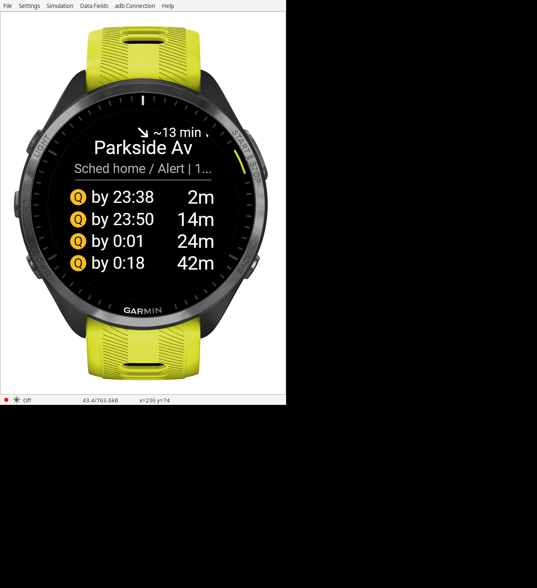

# NYC MTA for Garmin

A Monkey C watch app for nearby NYC subway arrivals, with cached boards and a bundled offline station map.



Simulator capture of scheduled departures from an offline run pack, not live predictions.
The manifest currently targets the Forerunner 965 only. This repo does not provide a
public hosted service.

## Architecture

```text
Garmin watch → phone over Bluetooth → HTTPS proxy → MTA GTFS-realtime
     ↓
cached boards / scheduled run pack / bundled station map
```

The watch sends requests through Garmin Connect on the paired phone. The separate
`mta-proxy` server combines MTA feeds and returns compact station boards. The watch renders arrivals and alerts, caches boards, and
uses a chunked station dataset when requests fail. The map has no live predictions
or schedules; an optional downloaded run pack supplies scheduled departures.

`GET /mta/board` accepts `lat`, `lon`, `limitStations`, `limitArrivals`, and optional
`station`, `route`, `dir=N|S`. The client requests five stations and eight arrivals,
then shows four rows. The matching proxy must support filtering before the arrival
limit and per-station `options` with direction/destination labels.
`GET /mta/pack?key=…` fetches an optional pack prepared by a separate planning client.

## Features and limits

- UP/DOWN cycles five nearby station complexes. START opens station, line and
  direction choices, recent commutes and service alerts. Tap refreshes.
- A glance shows the cached station and next train, with age/offline indicators.
- The entrance arrow uses the watch compass and nearest mapped entry-allowed
  entrance. It gives a direct bearing, not a walking route or accessibility guarantee.
- Walking time uses straight-line distance with a 1.3× grid allowance. It is an estimate.
- The offline map covers 231 station complexes, 260 platforms and 1,242 entrances
  within 10 km of **E 11th St & University Pl (40.73330, -73.99332)**. “Home” hints
  in the existing UI mean direct rides to this public reference area.

The [dataset metadata](resources/stations/meta.json) records input hashes and dates.
The bundled GTFS snapshot covers 2026-05-26 through 2026-10-31; its direct-ride hints
can become stale after schedule changes. Regenerate when replacing the inputs.
GPS acquisition, battery use, native Run continuity and compass accuracy need field
checks; passing simulator tests does not establish those behaviors.
Detailed fallback rules, timings and controls are in [docs/DESIGN.md](docs/DESIGN.md).

## Privacy and settings

Live board requests send latitude/longitude rounded to five decimal places. Selected
station, route and direction may be sent together with the coordinates. A no-GPS
cached-station refresh sends that station's point and ID instead. Both reveal location
context to the proxy. HTTPS protects transport; the operator still sees these queries.
This repo does not establish the operator's logging or retention policy.

The watch stores a primary board, up to eight station boards with fetch timestamps,
up to ten recent station/line/direction selections, a downloaded pack and app settings.
Expired packs stop being used but are not automatically deleted from storage. Recents
and cached boards have no automatic deletion deadline or in-app clear-data control.
The proxy URL and optional pack key are app properties. The pack key travels in a
query string; treat it as a credential and avoid logging full request URLs.
No phone-location API is used, and there is no default GPS fix.

Settings in Garmin Connect: **Proxy URL** (empty by default, HTTPS origin without a
trailing slash or `/mta`), **Distance** (walking time/meters/feet/miles), **Train buzz**
(off, 2 or 5 minutes; only while the board is visible), and **Run pack key** (optional;
lowercased, at least ten characters). Board and pack clients share URL validation
and reject temporary `trycloudflare.com` endpoints.

Permissions in [manifest.xml](manifest.xml): Positioning supplies watch GPS; Sensor
supplies compass heading; Communications makes proxy requests; Background refreshes
packs every 15 minutes when configured. The glance does not acquire GPS itself.

## Build and test

Install Garmin's [Connect IQ SDK](https://developer.garmin.com/connect-iq/sdk/), its
FR965 device files, and Java. Production and test builds were checked with SDK
9.2.0; the manifest minimum API is 4.0.0. Put the SDK `bin` directory
on `PATH`. Generate a local RSA developer key with OpenSSL if none exists:

```sh
mkdir -p "$HOME/.garmin" build
openssl genrsa -out "$HOME/.garmin/developer_key.pem" 4096
openssl pkcs8 -topk8 -inform PEM -outform DER -nocrypt \
  -in "$HOME/.garmin/developer_key.pem" -out "$HOME/.garmin/developer_key.der"
chmod 600 "$HOME/.garmin/developer_key.pem" "$HOME/.garmin/developer_key.der"
```

Keep signing keys local. To set a build-time proxy default, copy
`config/properties.xml.example` to `resources-local/properties.xml` and edit its URL.
`monkey.jungle` loads that gitignored resource directory after the public resources.
Without it, the default is empty and live requests are disabled until a URL is set
in Garmin Connect. Existing installed custom properties are preserved.

```sh
export OMP_NUM_THREADS=2 OPENBLAS_NUM_THREADS=2 MKL_NUM_THREADS=2
monkeyc -d fr965 -f monkey.jungle -o build/NycMta.prg -y "$HOME/.garmin/developer_key.der"
monkeyc -t -d fr965 -f monkey.jungle -o build/Tests.prg -y "$HOME/.garmin/developer_key.der"
# Start the SDK simulator, then run these separately:
monkeydo build/Tests.prg fr965 -t
monkeydo build/NycMta.prg fr965
```

The simulator requires a display; Linux can use a private Xvfb display for tests.
Some SDK runners exit 1 even after a `PASSED` summary: check the passed/failed/error
counts, not just the exit status. Tests cover location validity/lifecycle, stale
callbacks, offline data, caching, menus, directions, formatting and proxy settings.
The compiler performs Monkey C checks; no separate lint/type-check suite is configured.
For USB sideloading, copy `build/NycMta.prg` to the watch's `GARMIN/APPS/` directory.
`dev-loop.sh` is an optional desktop screenshot helper; its environment overrides
are listed at the top of the script. It restarts MonkeyDo launchers and focuses the
simulator window, so automated checks should use a separate headless display.
On Linux it optionally adds compatibility libraries from `$HOME/code/.webkit/libs`
or `GARMIN_WEBKIT_LIBS`; if that directory is missing, it uses system libraries.

## Regenerate offline data

Python 3's standard library is sufficient. The station CSV is included; the two
larger inputs are external. Obtain the exact snapshots recorded in
[meta.json](resources/stations/meta.json) from the proxy checkout or its listed MTA
sources. A fresh upstream download may have different hashes and outputs.

```sh
python3 tools/build_stations.py --gtfs "$MTA_GTFS_ZIP" --entrances "$MTA_ENTRANCES_JSON"
python3 tools/build_stations.py --gtfs "$MTA_GTFS_ZIP" --entrances "$MTA_ENTRANCES_JSON" --check
```

By default those inputs are read from `$HOME/code/mta-proxy/google_transit.zip` and
`$HOME/code/mta-proxy/data/entrances-2024.json`. `--check` rebuilds in memory and compares
all generated files byte for byte; it needs the same inputs as generation.

## Repo layout

- `source/`: watch code and `*Test.mc` simulator tests; `StationData.mc` is generated.
- `resources/stations/`: coordinate index, 16-station chunks and provenance metadata.
- `tools/build_stations.py`, `tools/data/`: deterministic generator and station CSV.
- `resources/settings/`, `config/`: public defaults and a local-override example.
- `shots/`: simulator captures. `docs/DESIGN.md`: detailed watch behavior.
- `resources/drawables/`: SVG launcher source and PNG; `render_icon.py` uses system librsvg/cairo.

Code is under the [MIT license](LICENSE). MTA input provenance is recorded separately
in the dataset metadata.
